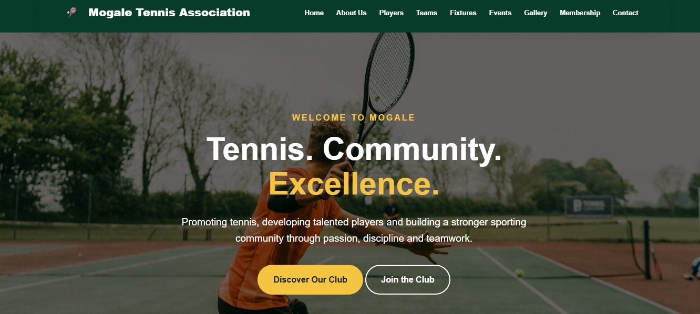
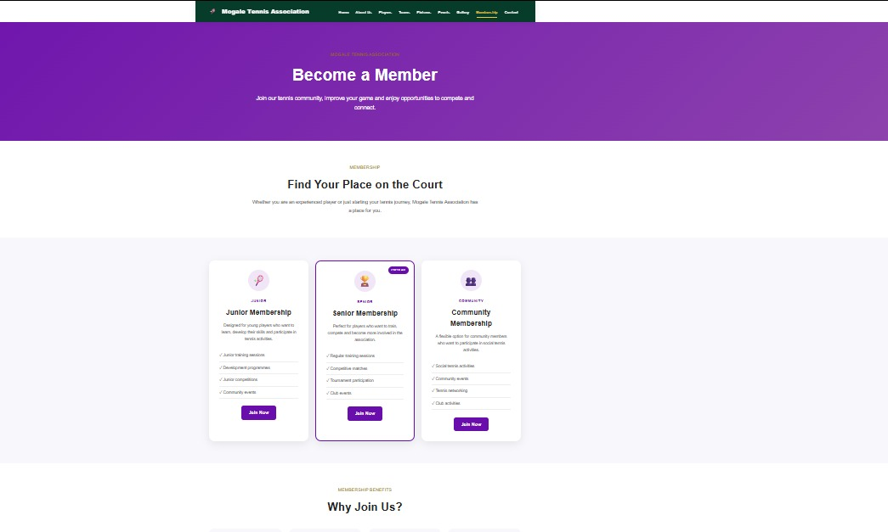
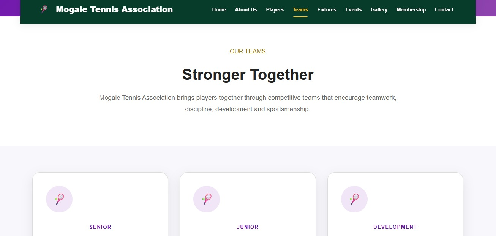
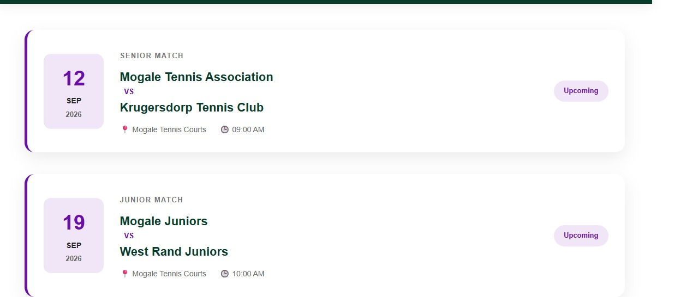
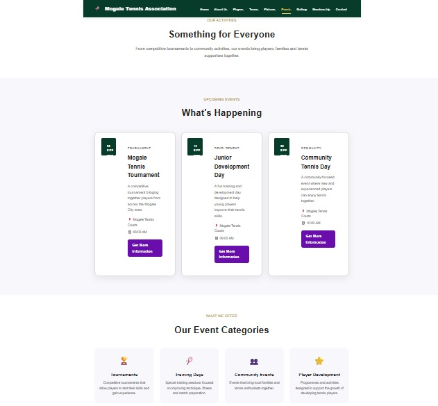
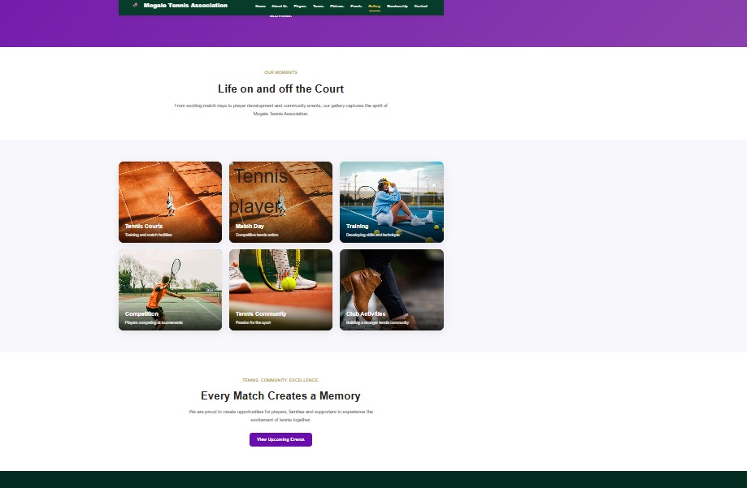
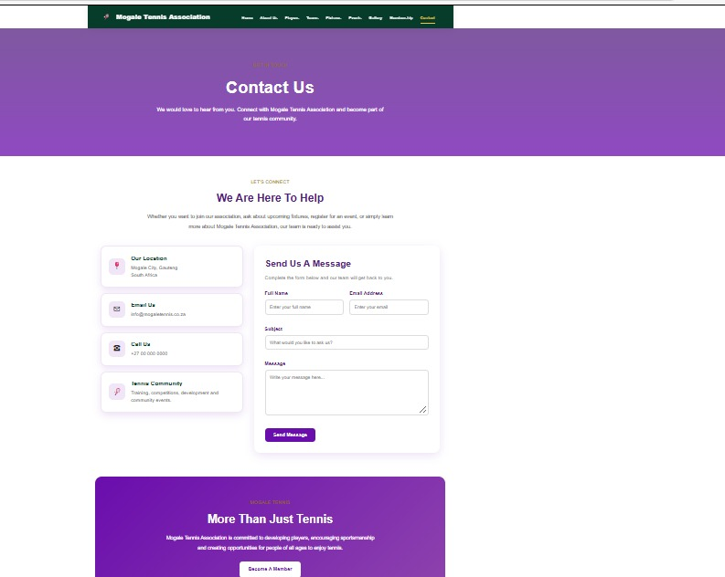

# 🎾 Mogale Tennis Association (MTA)

**Tennis Association Management System**

*A web-based system for managing tennis association information and activities.*

## 1. Project Overview

The Mogale Tennis Association Management System is a web-based application developed as part of our Work Integrated Learning (WIL) coursework.

The system aims to improve the management and accessibility of tennis association information and services. It provides information about membership, coaches, events and tennis facilities.

Members can register and log in to access their information, while administrators can manage important association activities through an administrative dashboard.

## 2. Project Purpose

The main purpose of the system is to support the Mogale Tennis Association by bringing important information and management functions together in one web-based platform.

The system aims to:

- Make association information easier to access.
- Allow users to register for membership.
- Provide members with access to their accounts.
- Allow users to view coaches, events and tennis facilities.
- Provide administrators with tools to manage association information.
- Improve the management of members, payments and contact messages.

## 3. Technologies Used

The following technologies and tools were used during development:

- HTML
- CSS
- Bootstrap
- PHP
- MySQL
- phpMyAdmin
- WAMP Server
- Git and GitHub

## 4. System Features

### Public Users

- View the home page.
- View information about the association.
- Register for membership.
- Log in as a member.
- View coaches.
- View events.
- View tennis complexes.
- Contact the association.

### Members

- Log in to their accounts.
- Access the member dashboard.
- View membership information.
- View events.
- View coaches.
- View facilities.
- Contact the association.
- Log out.

### Administrators

- Log in to the administrative section.
- Access the admin dashboard.
- Manage members.
- Manage coaches.
- Manage events.
- Manage tennis complexes.
- Manage payments.
- View contact messages.
- Log out.

## 5. Database

The system uses MySQL to store and manage information.

The database is named `mogale_tennis_db` and contains information relating to:

- Members
- Coaches
- Events
- Complexes
- Payments
- Messages
- Administrators

phpMyAdmin was used to manage the database during development.

## 6. Project Structure

The project is organised into different folders to keep the files structured and easier to manage.

The folders include:

- **Administration:** Contains files used for administrative functions.
- **Database:** Contains the database connection files.
- **Reusable Components:** Contains shared website components.
- **Images:** Stores images used throughout the website and README.
- **Main Website Files:** Contains the pages used by public users and members.

## 7. Running the Application Locally

The system can be run locally using WAMP Server.

Follow these steps:

1. Install WAMP Server.
2. Place the project folder inside the WAMP `www` directory.
3. Start the Apache and MySQL services.
4. Open phpMyAdmin.
5. Create a database named `mogale_tennis_db`.
6. Import the required database tables and data.
7. Check the database connection settings in `database/db.php`.
8. Open a web browser and access the project through the local WAMP server.

## 8. GitHub Repository

GitHub was used to store and manage the website's source code. It also allowed group members to share changes and keep track of development progress.

**GitHub Repository:**

[View the MTA Website Repository](https://github.com/Tshegofatso-Gabashane/MTA_XISD6329_Task1)

## 9. Website Screenshots

The following screenshots show the different pages and features of the Mogale Tennis Association website.

### Home Page

### About Page

### Membership Page

### Teams Page

### Players Page

### Fixtures Page

### Events Page

### Gallery Page

### Contact Page

## 10. Project Management

The website was developed as a group project as part of the Work Integrated Learning coursework. Group members contributed to the development of the system and its different features.

## 11. Contributors

Developed as a group project for the Mogale Tennis Association as part of our Work Integrated Learning coursework.
